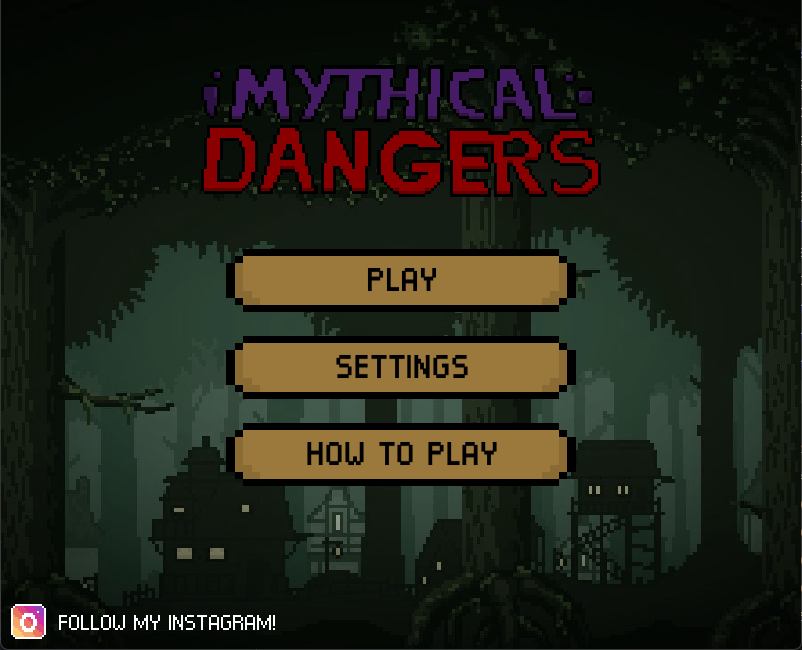
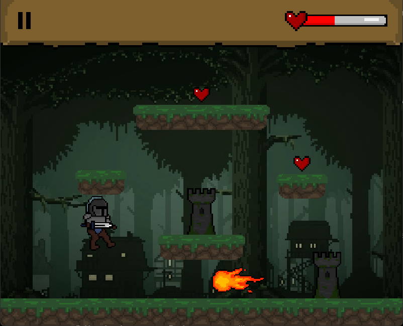
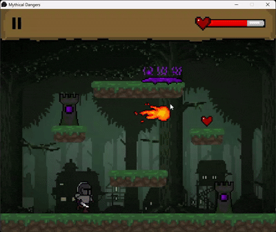

# Mythical Dangers

**A single-screen, 2D arcade survival game built with C++ and SFML.**

Developed as a personal project in **2022**, Mythical Dangers challenges players to survive for as long as possible in a fixed arena. Dodge fireballs entering from either side of the screen, avoid poison launched by automated turrets, and destroy turrets with your sword before they become overwhelming.


## Screenshots





## Features

- **Arcade survival gameplay:** Survive an increasingly difficult combination of incoming fireballs and poison-projectile attacks.
- **Dynamic turret aiming:** Turrets launch poison orbs along parabolic trajectories calculated from the player's position at firing time.
- **Custom character mechanics:** Player movement, jumping, gravity, platform collisions, sword attacks, and sprite-sheet animations.
- **Progressive difficulty:** Fireball spawn intervals shorten over time, while turret appearances add pressure.
- **Persistent progress and settings:** High scores, keyboard preferences, and audio levels are stored in JSON.

## Gameplay Demo



## Technical Highlights

### Real-time gameplay and collisions

Implemented the main game loop and input handling in C++ with SFML, along with custom player movement, jumping, gravity, platform interactions, projectile updates, and collision checks.

### Projectile trajectory calculation

In [`src/Turret.h`](src/Turret.h), turret-fired poison orbs use the player's position at firing time to calculate a parabolic launch trajectory. This is one part of the game's wider hazard and combat systems.

### Animation and persistence

Used sprite-sheet frame metadata in JSON to drive animations, and [`saves/user_data_and_preference.json`](saves/user_data_and_preference.json) to store the high score and user settings.

## Controls

| Action | Input |
| --- | --- |
| Move left / right | **A / D** or **Left / Right Arrow** (selectable in Settings) |
| Jump | **W**, **Up Arrow**, or **Space** |
| Move down | **S** or **Down Arrow** |
| Sword attack | **Left mouse button** |
| Pause / resume | **Esc** |

You can switch between **WASD** and **arrow-key** movement in the game's settings.

## Technologies

- **Language:** C++
- **Graphics, audio, and input:** SFML 2
- **Data storage and sprite metadata:** JSON using nlohmann/json
- **Original development period:** April–June 2022


## Build and Run (Windows — MinGW-w64)

Mythical Dangers uses **C++17 and SFML 2.6.2**. The build system automatically downloads and compiles SFML using your installed C++ compiler, so no separate SFML installation is required.

### Prerequisites

Install the following tools:

- **MinGW-w64 (64-bit)** — GCC/G++ compiler and `mingw32-make`
- **CMake 3.21+** — Build configuration
- **Git** — Required to download SFML 2.6.2 source
- **Internet connection** — Required for the first build

MSYS2 is **not required**. Any compatible standalone 64-bit MinGW-w64 toolchain can be used.

Ensure the tools are available in your Windows `PATH`.

To verify your installation, open **Command Prompt (CMD)** and run:

```cmd
g++ --version
mingw32-make --version
cmake --version
git --version
```

All four commands should display version information.

### Download and Build

1. Click **Code → Download ZIP** on this GitHub repository.
2. Extract the ZIP file to your preferred location.
3. Open **Command Prompt (CMD)** inside the extracted project folder.
4. Run:

```cmd
mingw32-make
```

The build system will automatically:

- Download SFML 2.6.2 source code.
- Compile SFML using your installed compiler.
- Compile and link Mythical Dangers.
- Generate `MythicalDangers.exe` in the project root.
- Attempt to copy the required SFML and runtime DLLs beside the executable.

The first build may take several minutes.

### Run the Game

After successfully building, simply **double-click `MythicalDangers.exe`** in the project root.

Alternatively, run:

```cmd
MythicalDangers.exe
```

**Important:** Keep the `gfx/`, `audio/`, `saves/`, and `icon.png` files in their original locations. The game uses relative paths to load its assets.

### Troubleshooting

**`g++`, `mingw32-make`, `cmake`, or `git` is not recognized**
- Verify the required tool is installed.
- Add its executable directory to your Windows `PATH`.
- Restart Command Prompt.

**CMake generator mismatch**
- If you previously built using Ninja or another generator, delete the old build directory:

```cmd
rmdir /s /q build
mingw32-make
```

**SFML download fails**
- Check your internet connection.
- Verify Git is installed and accessible.
- Retry the build.

**Missing DLL errors**
- Ensure the build completed successfully.
- Check that the required SFML and compiler runtime DLLs are present beside `MythicalDangers.exe`.
- If necessary, copy the matching runtime DLLs from your MinGW-w64 installation's `bin` directory.

**Missing textures, fonts, or audio**
- Run the executable directly from the project root.
- Do not move the executable away from its accompanying asset folders.

### Notes

- Building from source requires a compatible **64-bit MinGW-w64 toolchain**.
- The compiled game does not require the player to install a compiler.
- SFML 2.6.2 is downloaded and built automatically.
- The generated executable and DLLs are excluded from Git, so they must be built locally.
- Standalone MinGW-w64 compatibility should be verified with a clean build before being considered fully tested.


## Project Structure

- `src/` — C++ gameplay, physics, collision, menus, and settings code
- `gfx/` — images, sprite sheets, animation metadata, and fonts
- `audio/` — music and sound effects
- `saves/` — high scores and user preferences
- `include/nlohmann/` — JSON headers used by the game
- `CMakeLists.txt` — downloads and builds compatible SFML 2.6.2 source
- `Makefile` — convenient wrapper for CMake and MinGW Makefiles

## About

Created by **Nathanael Nicolas Chang** as a personal C++ game-development project in 2022. The project demonstrates gameplay programming and physics implementation using SFML rather than a full game engine.

**Third-party assets:** SFML, nlohmann/json, and any externally sourced music, sound effects, fonts, or artwork retain their respective licenses. Verify redistribution permissions and provide the appropriate credits before publishing their files in a public repository or release.
